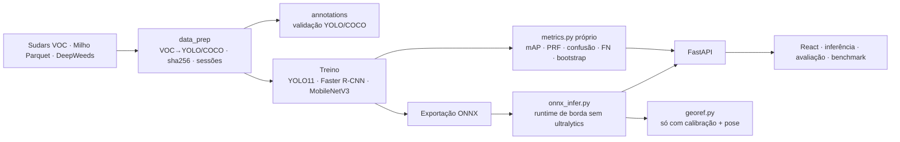

# 00 · Visão geral e arquitetura

WeedVision AI é uma plataforma de **pesquisa/demo** para treinar, avaliar e servir detectores de plantas daninhas em imagens RGB de campo. Ela **detecta e mede**. Não controla bomba, bico ou qualquer atuador, e **identificar uma daninha não é recomendar pulverização**: a decisão exige critério agronômico (espécie, estádio, limiar de dano econômico, produto registrado) e validação em campo.

## Três tarefas, três coisas diferentes
| Tarefa | Saída | Rótulo necessário | O que este projeto faz |
|---|---|---|---|
| **Classificação** | uma classe por imagem | rótulo por imagem | baseline no **DeepWeeds** (9 classes). **Nenhuma caixa é derivada daí.** |
| **Detecção** | caixas + classe + confiança | caixas por objeto | **Sudars** (treino/teste), YOLO11n/s e Faster R-CNN MobileNetV3 |
| **Segmentação** | máscara por pixel/instância | polígonos/máscaras | ❌ **não treinada** (nenhum dataset obtido tem máscaras utilizáveis aqui) |

Rótulos de imagem inteira **nunca** foram convertidos em caixas: seria inventar anotação.

## Fluxo

## Princípios de implementação
1. **Métricas próprias, aplicadas igual a todos os modelos**, conferidas contra `pycocotools` (testes `test_bate_com_pycocotools`, tolerância 2·10⁻³). Os números "da biblioteca de treino" não são usados nas tabelas.
2. **Nada digitado à mão:** a API e o registry leem `runs/eval/*.json` gerados pelos scripts.
3. **Split por sessão/origem**, não por imagem; a definição de sessão é uma **suposição** documentada (doc 02).
4. **Domínio explícito:** cada modelo carrega `domain_note`; avaliações em outro domínio são rotuladas.
5. **Borda sem AGPL no caminho de inferência:** `weedvision/onnx_infer.py` não importa `ultralytics` (os *pesos* continuam sob AGPL; doc 10).

## Mapa do repositório
`weedvision/` núcleo (dados, anotações, augment, métricas, ONNX, georef, calibração, drift) · `scripts/` treino/avaliação/benchmark · `backend/app/` API · `frontend/` painel · `tests/` · `notebooks/` · `docs/` · `models/` (pesos, ONNX, registry) · `sample_data/` · `infra/` Docker.
